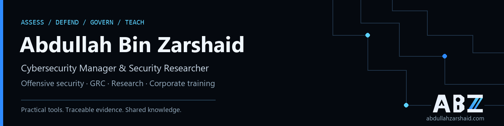

  

# Abdullah Bin Zarshaid

### Cybersecurity Manager & Security Researcher
**Information Security · GRC · Security Assessment · Corporate Training**

I work as a cybersecurity manager, combining hands-on security assessment with information-security governance, risk and compliance. My work spans web and API security, network security, practical tooling, research and teaching. This portfolio brings together tools I build, coauthored research and learning resources.

My personal site is [abdullahzarshaid.com](https://abdullahzarshaid.com/). This GitHub account holds my own tools, research and teaching material.

**[Run the Security Self-Assessment](https://abdullahzarshaid.github.io/security-assessment-tools/)** · **[Try PostureKit](https://abdullahzarshaid.github.io/posturekit/)** · **[Try EvidenceGate](https://abdullahzarshaid.github.io/evidencegate/)** · **[Read the handbook](https://abdullahzarshaid.github.io/network-security-assessment-handbook/)** · **[Open the GRC Documentation Kit](https://abdullahzarshaid.github.io/grc-documentation-kit/)**

**Latest (26 October 2026):** the new [Security and Compliance Self-Assessment](https://abdullahzarshaid.github.io/security-assessment-tools/) is live, fifteen in-browser readiness assessments (NIST CSF 2.0, ISO 27001, SOC 2, cloud and identity, AI security, incident response, GDPR, vendor risk, recovery, secure delivery and more) plus five hands-on security tools, where every gap links straight to a remediation template. It pairs with the [GRC Documentation Kit](https://github.com/abdullahzarshaid/grc-documentation-kit), 121 original documents and 56 Excel registers for ISO/IEC 27001, ISO/IEC 27701, SOC 2, GDPR, HIPAA and AI governance, with a crosswalk between them and a searchable [online site](https://abdullahzarshaid.github.io/grc-documentation-kit/kit.html). PostureKit [0.6](https://github.com/abdullahzarshaid/posturekit/releases/latest), EvidenceGate [1.0.0](https://github.com/abdullahzarshaid/evidencegate/releases/latest), the handbook's [October 2026 edition](https://github.com/abdullahzarshaid/network-security-assessment-handbook/releases/latest) and the GRC trackers [1.0.1](https://github.com/abdullahzarshaid/grc-excel-templates/releases/latest) are tagged releases. Next: a Web and API penetration testing manual, lab targets only, written from the basics up.

  
  
  
  

## Choose your starting point

**Use a tool:** [PostureKit demo](https://github.com/abdullahzarshaid/posturekit/tree/main/examples) · [EvidenceGate demo](https://github.com/abdullahzarshaid/evidencegate/tree/main/examples)

**Learn the workflow:** [From Scope to Security Evidence](https://github.com/abdullahzarshaid/ethical-hacking-labs/tree/main/series)

**Run security work in spreadsheets:** [six GRC trackers, pick one online](https://abdullahzarshaid.github.io/grc-excel-templates/)

- **[PostureKit](https://github.com/abdullahzarshaid/posturekit)**: Windows, directory and wireless configuration assessment: evidence collection, rule-based analysis and scanner imports. [Project page](https://abdullahzarshaid.github.io/posturekit/).
- **[EvidenceGate](https://github.com/abdullahzarshaid/evidencegate)**: local integrity, HTTP capture-structure, CVSS and scope checks for security assessments. [Project page](https://abdullahzarshaid.github.io/evidencegate/).
- **[Security and Compliance Self-Assessment](https://github.com/abdullahzarshaid/security-assessment-tools)**: fifteen free, in-browser readiness assessments (NIST CSF 2.0, ISO 27001, SOC 2, cloud, AI, incident response, GDPR, vendor risk and more) on an honest five-point evidence scale, plus five security tools (subnet calculator, JWT inspector, header analyzer, access-control demo, risk matrix). Answers never leave your browser, and every gap links to a remediation template. [Run it online](https://abdullahzarshaid.github.io/security-assessment-tools/).
- **[GRC Documentation Kit](https://github.com/abdullahzarshaid/grc-documentation-kit)**: 121 original policies, procedures, registers and playbooks for ISO/IEC 27001, ISO/IEC 27701, SOC 2, GDPR, HIPAA and AI governance, in Markdown, Word and Excel, with a crosswalk between the frameworks. [Read online](https://abdullahzarshaid.github.io/grc-documentation-kit/kit.html).
- **[GRC Excel Starter Templates](https://github.com/abdullahzarshaid/grc-excel-templates)**: six original MIT-licensed blank trackers for risk, evidence, remediation, vendors, policies and assessment scope. Not complete framework checklists or certification tools. [Browse online](https://abdullahzarshaid.github.io/grc-excel-templates/).
- **[Network Security Assessment Handbook](https://github.com/abdullahzarshaid/network-security-assessment-handbook)**: methodology, worked scenarios and protocol reference. [Read online](https://abdullahzarshaid.github.io/network-security-assessment-handbook/handbook.html).
- **[Ethical Hacking Labs](https://github.com/abdullahzarshaid/ethical-hacking-labs)**: 19 topic guides for isolated practice, with credited student examples.

## Research & contributions

**CWE proposal, explicit session termination**

I submitted *Improper Enforcement of Explicit Session Termination* to the CWE Program. The proposal is publicly tracked in the **[CWE Content Development Repository, issue #224](https://github.com/CWE-CAPEC/CWE-Content-Development-Repository/issues/224)**, submission **ES2609-7b54439f**.

**Status checked 25 September 2026:** receipt acknowledged (`Phase02-Ack-Receipt`); evaluation pending. This is a proposal, not an assigned or accepted CWE entry. The linked issue is the source for subsequent status changes.

**Session-lifecycle research**

*Lifecycle Conditions in CWE-613 Disclosures: A Reproducible, Evidence-Linked Characterisation* (earlier working title *Logout Is Not Expiration*), with Shahbaz Akhtar Siddiqui. Manuscript under peer review; the data and code repository will be opened when the review concludes. Record on [ORCID](https://orcid.org/0009-0000-8354-5177).

## Tools & technology

**Build & automate**

   &nbsp;
   &nbsp;
   &nbsp;
  

[Python](https://www.python.org/) · [PowerShell](https://learn.microsoft.com/powershell/) · [Bash](https://www.gnu.org/software/bash/) · [Git](https://git-scm.com/)

**Platforms & environments**

   &nbsp;
   &nbsp;
   &nbsp;
  

[Kali Linux](https://www.kali.org/) · [Linux](https://www.kernel.org/) · [Docker](https://www.docker.com/) · [Microsoft Azure](https://azure.microsoft.com/)

**Security assessment & analysis**

   &nbsp;
   &nbsp;
   &nbsp;
  

[Burp Suite](https://portswigger.net/burp) · [Nmap](https://nmap.org/) · [Wireshark](https://www.wireshark.org/) · [Metasploit](https://www.metasploit.com/)

Also in the assessment workflow: **[Greenbone / OpenVAS](https://www.greenbone.net/en/)** and **[Active Directory](https://learn.microsoft.com/windows-server/identity/ad-ds/get-started/virtual-dc/active-directory-domain-services-overview)**.

---

## How I approach the work

- **Evidence before conclusions.** Keep observations, interpretations and confirmed impact distinct.
- **Clear scope.** Assess only authorized systems; keep private engagement material out of public examples.
- **Useful artifacts.** Prefer inspectable Python and PowerShell, documented limits and reproducible examples.

## Across the security lifecycle

- **Assess & investigate:** Web and API security; network and wireless assessment; Windows, Active Directory and cloud configuration.
- **Govern & improve:** Information-security governance; risk assessment; control mapping; evidence quality and remediation tracking.
- **Teach & research:** Corporate training; practical labs; assessment methodology; reproducible security research.

Teaching materials retain contributor credit; research identifies its coauthors and publication status
in the project repository. My earlier master's work on SDN-enabled IoT security is being revisited;
it is not presented here as a new released tool or a published result.

## Useful community resources

[OWASP](https://owasp.org/) · [NIST Cybersecurity Framework](https://www.nist.gov/cyberframework) ·
[MITRE ATT&CK](https://attack.mitre.org/) · [PortSwigger Web Security Academy](https://portswigger.net/web-security)

These are independent third-party resources, not my projects or endorsements of my work.

## Connect

[LinkedIn](https://www.linkedin.com/in/abdullahbinzarshaid) · [Website](https://abdullahzarshaid.com/) · [ORCID](https://orcid.org/0009-0000-8354-5177) · [Email](mailto:abdullahbinzarshaid@gmail.com)

For a tool issue, please use its repository's issue tracker with a **synthetic, sanitized example**, never live credentials or client evidence.
